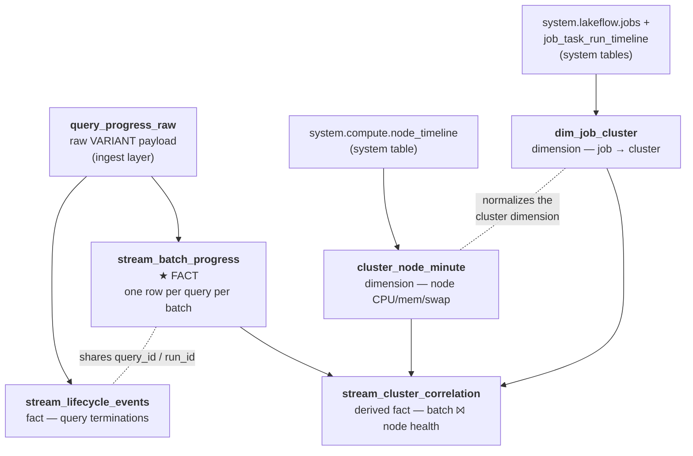

# Structured Streaming Observability & Monitoring

A guide to capturing Spark Structured Streaming metrics **into Delta tables** to build an observability data model, with a focus on heavy Kafka ingestion. The scope is deliberately limited to signals you can **capture and persist to Delta** — anything that only lives in a UI is out of scope, because you can't alert, trend, or join on it.

> **Where the code lives.** This document is the *explanation*; the runnable implementation lives in `notebooks/`. It is the **consumption side only** — point it at your own Kafka. This guide stays code-free on purpose so it reads top-to-bottom; dip into the notebooks when you want the exact implementation.

### Repository layout

| Notebook | Purpose |
|---|---|
| `notebooks/00_static_dims.py` | Example static dimension tables the pipeline joins against |
| `notebooks/01_observability_listener.py` | Registers the `StreamingQueryListener` + async Delta writer (§1) |
| `notebooks/02_streaming_pipeline.py` | The consumption pipeline: Kafka → join dims → transform → Delta, with `df.observe` data-quality metrics |
| `notebooks/03_model_views.sql` | Parsed facts/views over the raw table (§6) |
| `notebooks/04_analysis.sql` | Example queries answering the §3–§5 questions |
| `notebooks/05_system_table_views.sql` | Cluster-metrics layer over the system tables (§4) |
| `notebooks/06_table_comments.sql` | Table/column comments for AI/BI Genie |

Run them in order `00` → `06` on a Databricks cluster, pointing `02` at your Kafka bootstrap servers and topic. Set the target Unity Catalog once at the top of each notebook (it defaults to `observability`).

---

## 1. How the metrics are collected

Everything in the data model comes from **three sources**, all of which land in Delta:

1. **The streaming query itself**, via a *listener* that Spark notifies after every micro-batch.
2. **Custom data-quality checks** you attach to the stream, which ride along in that same notification.
3. **Cluster health**, from a Databricks system table that records per-node CPU and memory.

### The listener — one record per batch

Spark lets you register a listener that it calls every time a micro-batch finishes. On each call it hands you a **progress** object: a JSON document containing nearly every stream-level metric for that batch — rows processed, throughput, Kafka lag, timing breakdowns, state size, and more. That JSON is the raw material for the whole model: **one record per query, per batch.**

Two things matter about how you handle it:

- **Keep the callback non-blocking.** The listener runs on one of Spark's internal threads. If you write to Delta directly inside it, you stall the stream. The pattern instead is: the callback does nothing but drop the JSON onto a small in-memory queue, and a **separate background thread** batches those up and writes them to Delta. A Delta write costs about a second, so you buffer many records per write.
- **Store the raw JSON as-is, in a `VARIANT` column.** Rather than parsing the payload into typed columns at write time, land the whole document untouched. This means the table **never needs a schema migration** when a new Spark version adds or renames a field. You parse the fields you care about later, in views on top (see §6).

One listener registered on the session captures **every** query running on it — so a single table collects metrics for all your streams at once.

### Custom data-quality metrics

The listener gives you what Spark knows on its own. But Spark knows nothing about the *contents* of your data — it can't tell you how many records had a null key or failed a business rule, because those depend on what's inside each message.

Spark's `observe` feature closes that gap. You give it a name and a few simple tallies ("count the rows", "count the rows with a null symbol"), and Spark computes them **while it's already reading each batch** — no second pass, effectively free. The results arrive attached to the **same** progress notification the listener already receives, so your custom numbers flow into Delta through the exact same pipe as the built-in metrics. No extra job, no extra table.

Typical uses for Kafka ingestion:
- **Bad-data rate** — what fraction of the batch was malformed or unparseable. A sudden jump usually means an upstream producer changed or broke.
- **Business-rule violations** — null keys, missing required fields, out-of-range values — caught the moment they land, not three tables downstream.
- **Data freshness** — the oldest and newest event-times in the batch, so you know how current the data you're ingesting really is.

### Three identity fields you must understand

When you aggregate or join this data, these three fields from the progress record decide correctness:

- **`id`** — the **stable** identity of a logical stream. It survives restarts. Use it as your join key.
- **`runId`** — a **new** value every time the query starts or restarts. Use it to tell one run from another.
- **`batchId`** — the batch number *within a run*. It can **re-execute** after a failure, so the same `batchId` may appear twice. It is **not** a unique business event — decide explicitly how you want retries and checkpoint replays to count.

---

## 2. What to collect — the metric catalog

The metrics group naturally by the question each one answers.

| Group | What it tells you | Key fields |
|---|---|---|
| **Throughput / batch health** | Is it keeping pace? | `numInputRows`, `inputRowsPerSecond`, `processedRowsPerSecond`, `batchDuration` (track p50/p95/p99) |
| **Backlog / freshness** ⭐ | Is it falling behind? | per-Kafka-source `avgOffsetsBehindLatest`, `maxOffsetsBehindLatest`, `minOffsetsBehindLatest`, `estimatedTotalBytesBehindLatest`; plus **output freshness** = age of the latest sink commit |
| **Execution bottleneck** | *Why* is a batch slow? | the `durationMs` phase timers: `addBatch`, `latestOffset`, `getBatch`, `queryPlanning`, `walCommit`, `triggerExecution` |
| **State health** (stateful queries only) | Is state leaking? | per state operator: `numRowsTotal`, `memoryUsedBytes`, `numRowsDroppedByWatermark`; watermark progression |
| **Custom / data quality** | Is the data itself healthy? | whatever you defined via `observe` |

### The single most important insight

**Throughput rates alone are misleading.** When a stream is continuously busy, the input rate and the processed rate **converge — even as the upstream backlog explodes.** That happens because both rates are computed only from the rows Spark *actually processed*, never from true producer demand. If you're throttled or under-provisioned, the rates look calm while you fall further and further behind.

> **The deciding health signals are backlog and output freshness.** Batch duration tells you about scheduling pressure. Rates and the timing breakdown explain *why*. But backlog is what tells you whether you're winning or losing.

---

## 3. Reading the metrics that actually matter

### Can the job keep up?

Judge this over a **rolling window**, never a single batch, using two signals together:

**Scheduling pressure** — a timing ratio for a fixed-interval trigger:

```
scheduling_pressure = batchDuration / triggerInterval
```

Below ~0.8 means healthy headroom (each batch finishes within ~80% of the interval). Around 1.0 means saturated — any spike causes queueing. Above 1.0, sustained, means the stream queues up and eventually fails. This is *not* CPU utilization; it's purely about whether a batch fits inside its time slot.

> `scheduling_pressure` is a **derived heuristic** we compute ourselves — not a built-in Spark or Databricks metric. The 0.8 threshold is a starting point; tune it.

**Backlog trend** — the authoritative "falling behind" signal: is `maxOffsetsBehindLatest` (or `estimatedTotalBytesBehindLatest`) rising across several consecutive batches? Rising = falling behind. Falling while the processed rate exceeds the input rate = catching up. Flat with roughly equal rates = steady state.

**A concrete example of why rates fool you:** during a producer burst you might see input ≈ processed ≈ 50k rows/s and conclude all is well — while `maxOffsetsBehindLatest` climbs 2M → 5M → 9M over three batches and each batch takes 58s against a 60s trigger. The verdict is **saturated and losing ground**, despite the flat, healthy-looking throughput. The fix is more consumers/partitions or more headroom and compute — but you'd never know from the rates.

### How much upstream pressure is there?

- `estimatedTotalBytesBehindLatest` — bytes waiting to be consumed; the best proxy for producer pressure.
- `maxOffsetsBehindLatest` — the worst single partition's lag. It catches **skew** — one hot partition stalling the whole batch — that an average would hide.
- A big gap between the max and the average lag points straight at partition skew / a rebalance need.

> **A small, persistent lag is normal — not a backlog.** The Kafka source checks for the latest offsets *after* each batch finishes, so on a busy topic these numbers are never exactly zero even when you're fully keeping up. Alert on the **trend**, never on a single non-zero reading.

### Is the output actually fresh?

Backlog misses stalls on the *sink* side. So also track the **age of the latest successfully committed output** — `now − max(ingest_ts)` on your Delta target — and alert when it breaches your freshness SLO. This is the number your downstream consumers actually feel.

### Where is the time going?

Each batch's duration breaks down into phases. Chart them over time; the one that grows is your bottleneck:

- **`addBatch`** growing → sink write / shuffle / compute bound.
- **`latestOffset` / `getBatch`** growing → the source (Kafka broker) is slow.
- **`queryPlanning`** growing → too many small files or an overgrown query plan.
- **`walCommit`** growing → checkpoint storage (cloud object store) latency.

> Don't add these up — the overall and sub-phase timers overlap, and which keys appear depends on the Spark version and source.

### Is state leaking? (stateful queries only)

For joins, aggregations, dedup, and the like: if state memory/row counts climb **while the watermark advances normally**, you likely have a genuine leak — check watermark correctness and TTL. A high count of rows dropped by the watermark means late data is being discarded and your watermark may be too aggressive. The real alarm is state growing **while the watermark is stalled**.

---

## 4. Cluster metrics — is the box the problem?

Stream-level metrics tell you a query is slow. **Cluster metrics tell you whether the machine is the cause.** The source is the `system.compute.node_timeline` system table — one row per node, per minute, with CPU, memory, swap, and (usefully) actual Spark JVM heap.

A few things to know about it:
- `mem_used_percent` includes background processes — it is **not** just the Spark JVM heap (the heap is available separately).
- It is **not real-time**: rows land within about an hour, and very short-lived nodes may never appear.
- It keeps **90 days** of history (versus 365 for the `system.lakeflow` job tables). Snapshot it into your own table if you need longer.

**Resolve the cluster by job name, never by a hard-coded id.** A job cluster gets a brand-new `cluster_id` every time it restarts, so pinning an id breaks on the next run. Instead you look the job up by its (stable) name in `system.lakeflow`, follow it to whichever cluster(s) ran it, and join to the node metrics by cluster and time overlap. This mapping is materialized as the `dim_job_cluster` dimension in the data model (§6) so everything downstream joins cleanly.

### What to watch, and why it matters

| Signal | Threshold (tune) | What it means for heavy Kafka ingestion |
|---|---|---|
| **Driver memory** | sustained > 80–85% | Driver OOM risk — batch coordination, listener back-pressure, too many streams on one driver |
| **Driver swap** | any, sustained | Swapping → GC pauses → batch-duration spikes → backlog |
| **Driver CPU** | sustained near 100% | Driver-bound: many small tasks, many streams, heavy planning |
| **Worker CPU** | sustained near 100% | Compute-bound batches → raise parallelism / scale out |
| **Worker I/O wait** | elevated | Shuffle spill / checkpoint I/O / slow object store |
| **Worker memory** | high + GC pauses | State-store pressure, large shuffles, undersized executors |

**The correlation play:** when you see a `batchDuration` spike, line it up in time with the node metrics. Driver memory climbing with it → driver bottleneck (consolidate streams or size up the driver). Worker CPU pegged → scale out. `walCommit` and I/O wait rising together → checkpoint storage latency. The data model's `stream_cluster_correlation` view does exactly this join for you.

---

## 5. Detecting degradation — an alert policy

Starting points; tune to your SLOs. Every source is a Delta table in the model, so each alert is just a scheduled query.

| Alert | Fires when | Based on |
|---|---|---|
| **Falling behind** | Backlog rises across N batches, or output freshness breaches the SLO | batch progress |
| **Slow batches** | p95 `batchDuration` exceeds the trigger interval over a window | batch progress |
| **Stalled query** | No completed batch beyond the expected budget *while* data is waiting | a watchdog polling query status → Delta |
| **State growth** | State size climbs while the watermark stalls | batch progress (state fields) |
| **Driver pressure** | Driver memory > 85% sustained, or any swap | node metrics |
| **Compute-bound** | Worker CPU pegged while batch duration rises | node metrics + batch progress |
| **Failure / flapping** | Unexpected termination or excessive restarts | lifecycle events |
| **Monitoring blind** | Telemetry queue full / writer heartbeat gone | the writer's dropped-telemetry counter |

> **"No progress events" does not mean failure.** Spark emits an *idle* signal when it's simply waiting for data, and a batch's progress is only finalized once the batch completes. Detecting a genuinely stuck batch needs an **external watchdog** polling the query's status, not just the absence of listener events.

---

## 6. The observability data model

This is the heart of the design: a small set of Delta tables and views that together answer every question in §3–§5 from plain SQL. It's organized as a **star schema that snowflakes on the cluster side** — one central fact about streaming batches, a companion fact for lifecycle events, and a cluster dimension that is split (normalized) across two tables because job→cluster and cluster→node-metrics are naturally separate grains.

Everything is fed by the listener writer (§1) and by the Databricks system tables, and everything parses out of the single raw table — so the model never breaks when Spark changes its payload.

### How the pieces relate



*Read it as:* the raw table feeds the two batch-level facts; the system tables feed the two cluster dimensions; and `stream_cluster_correlation` is a pre-joined convenience fact that ties a batch's performance to the health of the machine that ran it — resolving the cluster through `dim_job_cluster` (by job name), never a hard-coded id.

### What each table is for

**`query_progress_raw` — the raw ingest layer.**
One row per progress event, holding the untouched JSON payload in a `VARIANT` column, plus the time it was written. This is the source of truth and the reason the model survives Spark upgrades. You rarely query it directly; everything else is a view on top of it. *Think of it as the landing zone.*

**`stream_batch_progress` — the central fact (one row per query, per micro-batch).**
The workhorse. Every batch becomes one row with its throughput, batch duration, the `durationMs` phase breakdown, Kafka backlog (max/avg/min offsets behind and bytes behind), state metrics, and your custom `observe` data-quality tallies — all parsed into clean typed columns.
*Insights it unlocks:* Is the stream keeping pace? Is backlog trending up or down? Which phase is the bottleneck? How much malformed data arrived, batch by batch? This one table answers most of §3 on its own. Grain: `(query_id, run_id, batch_id)`.

**`stream_lifecycle_events` — the companion fact for start/stop/termination.**
One row whenever a query terminates, including any exception. It shares `query_id`/`run_id` with the central fact so you can line a failure up against the batches that led to it.
*Insights it unlocks:* Did a stream die, and why? Is it flapping (restarting repeatedly)? This drives the failure/flapping alert.

**`dim_job_cluster` — the job → cluster dimension.**
Maps each Databricks Job (by its stable name) to the actual compute cluster(s) that ran it, with the time window each ran for. It exists precisely because a job cluster's id changes on every restart — this dimension absorbs that churn so downstream joins stay stable.
*Insights it unlocks:* Which physical cluster was behind a given stream at a given time? It's the bridge between "a stream" and "a machine."

**`cluster_node_minute` — the node-health dimension.**
Per-node, per-minute CPU (busy and I/O-wait), memory, swap, and true Spark JVM heap. It hangs off `dim_job_cluster` via the cluster id — the "snowflake" arm of the schema.
*Insights it unlocks:* Was the driver about to OOM? Were the workers CPU-pegged? Was the box swapping (which quietly wrecks batch times)?

**`stream_cluster_correlation` — the derived fact that ties it together.**
A ready-made join of each micro-batch to the driver/worker metrics of the cluster that ran it, with the cluster resolved dynamically by **job name** through `dim_job_cluster`. Filter it by `job_name`.
*Insights it unlocks:* Does a batch-duration spike line up with driver memory climbing, or with workers pegged at 100% CPU? This is the §4 "is the box the cause?" question answered in a single table. (It is populated for streams that run as Databricks **Jobs** — an all-purpose cluster won't appear in `dim_job_cluster`.)

### Reading the raw table in a view

Parsing from the `VARIANT` payload is straightforward — you pick fields out of the JSON with a path accessor. For example, a batch's worst-partition Kafka lag is simply:

```
payload:sources[0]:metrics:maxOffsetsBehindLatest
```

Every typed column in `stream_batch_progress` is one line like that. (The full view definitions, with a comment on every column for AI/BI Genie, are in `notebooks/03_model_views.sql` and `notebooks/05_system_table_views.sql`.)

### Why this shape pays off

Because it's one coherent model, a single set of SQL queries — and one dashboard, and one set of alerts — can answer all of §3–§5: the keep-up trend, upstream pressure, the bottleneck phase, data quality, and the driver/worker correlation. Add a new stream and it shows up automatically; the listener already captures every query on the session. Upgrade Spark and nothing breaks, because the typing lives in views over a `VARIANT`, not in the table itself.

---

## Key references
- Structured Streaming monitoring: https://docs.databricks.com/aws/en/structured-streaming/stream-monitoring
- Observable metrics (`observe()`): https://docs.databricks.com/aws/en/structured-streaming/stream-monitoring#defining-observable-metrics-in-structured-streaming
- Observability best practices (streaming key metrics): https://docs.databricks.com/aws/en/data-engineering/observability-best-practices
- Compute system table (`node_timeline`): https://docs.databricks.com/aws/en/admin/system-tables/compute
- Jobs system tables (`job_task_run_timeline`, join patterns): https://docs.databricks.com/aws/en/admin/system-tables/jobs
